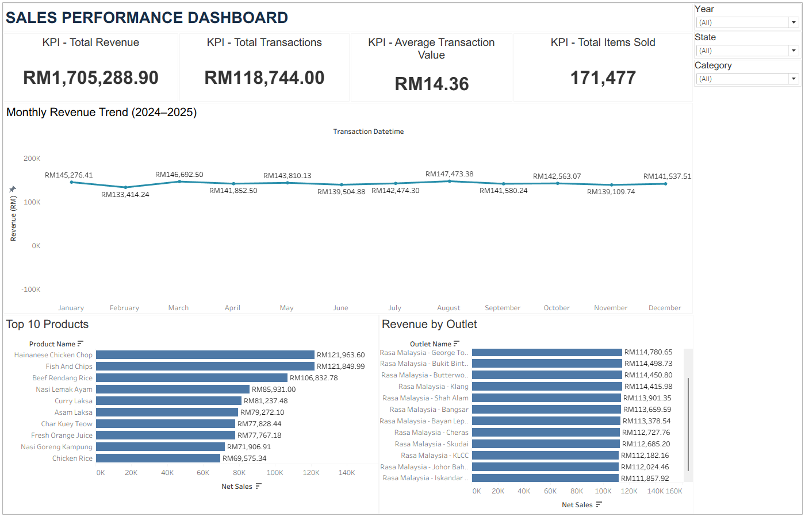
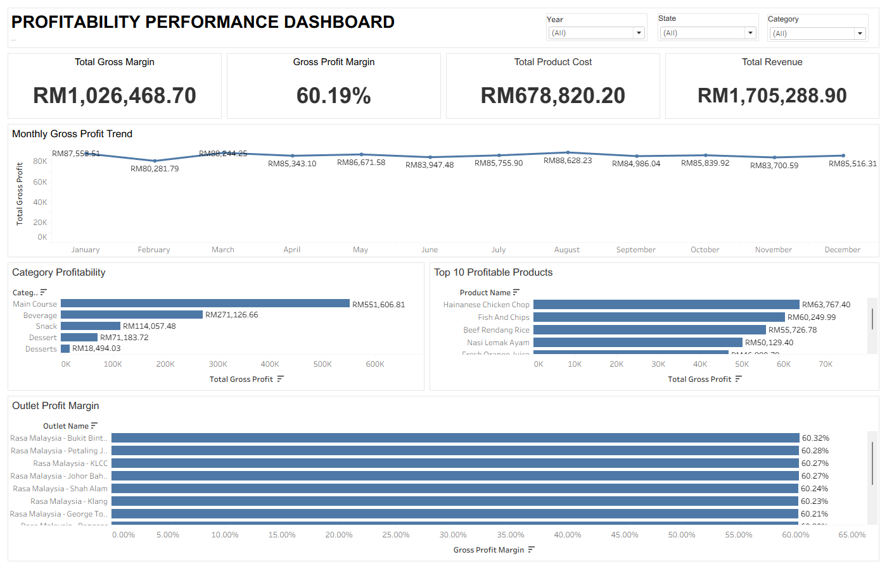

# Malaysian F&B Sales & Profitability Analytics

## Project Overview

An end-to-end Data Analyst portfolio project examining sales performance and gross profitability for a fictional Malaysian Food & Beverage (F&B) chain.

The project analyses approximately **120,000 synthetic sales transactions** across **15 outlets, 30 products, and 8,000 customers** during 2024–2025.

**Python (Pandas)** was used for data cleaning and ETL, **PostgreSQL** for relational database management and SQL analysis, and **Tableau** for interactive business intelligence dashboards.

**Dataset Disclaimer:** All business records are synthetic and do not represent actual company performance.

## Business Objectives

- Analyse revenue, transaction volume, and sales trends.
- Identify high-performing products and outlets.
- Evaluate gross profit and gross profit margins.
- Compare profitability across product categories and outlets.
- Identify potential opportunities for improving business profitability.
- Develop actionable, data-driven business recommendations.

## Tools and Technologies

| Tool | Purpose |
|---|---|
| Python (Pandas) | Data cleaning, validation, and ETL |
| Jupyter Notebook | Reproducible data preparation |
| PostgreSQL | Relational database management |
| SQL | JOINs, aggregations, CTEs, and window functions |
| Tableau | Interactive sales and profitability dashboards |
| Git & GitHub | Version control and project documentation |

## Data Model

The PostgreSQL database consists of five tables:

- `fact_sales` — Sales transactions, quantities, revenue, costs, and gross profit.
- `fact_payments` — Payment methods and payment amounts.
- `dim_products` — Product information, categories, selling prices, and costs.
- `dim_outlets` — Outlet information and geographical locations.
- `dim_customers` — Customer identifiers and customer segments.

Primary and foreign keys establish relationships between transactional and dimensional tables.

## Project Workflow

### 1. Data Cleaning and Preparation (Python)

Performed data cleaning and validation using Python (Pandas).

Key tasks included:

- Identifying and removing duplicate records.
- Handling missing values and inconsistent date formats.
- Standardising numerical data types.
- Validating transaction and customer identifiers.
- Preparing cleaned datasets for PostgreSQL ingestion.

### 2. Database Development (PostgreSQL)

- Designed a relational database using primary and foreign keys.
- Created fact and dimension tables.
- Loaded cleaned datasets through a Python ETL workflow.
- Validated data integrity and table relationships.

### 3. SQL Business Analysis

Developed SQL queries using JOINs, CTEs, aggregations, and window functions to analyse:

- Monthly and annual revenue trends.
- Revenue by outlet and state.
- Top-performing products and categories.
- Gross profit and gross profit margins.
- Customer segments and payment methods.

### 4. Tableau Dashboard Development

Developed two interactive Tableau dashboards to communicate sales performance and profitability insights.

#### Sales Performance Dashboard

**Key KPIs:**

| KPI | Value |
|---|---:|
| Total Revenue | RM1,705,288.90 |
| Total Transactions | 118,744 |
| Average Transaction Value | RM14.36 |
| Total Items Sold | 171,477 |

**Dashboard Visualisations:**

- Monthly Revenue Trend
- Top 10 Products by Revenue
- Revenue by Outlet
- Interactive Year, State, and Category Filters

#### Profitability Performance Dashboard

**Key KPIs:**

| KPI | Value |
|---|---:|
| Total Gross Profit | RM1,026,468.70 |
| Gross Profit Margin | 60.19% |
| Total Product Cost | RM678,820.20 |
| Total Revenue | RM1,705,288.90 |

**Dashboard Visualisations:**

- Monthly Gross Profit Trend
- Gross Profit by Product Category
- Top 10 Profitable Products
- Gross Profit Margin by Outlet
- Interactive Year, State, and Category Filters

## Key Business Findings

### 1. Revenue Performance

The business generated **RM1,705,288.90 in total revenue** across 2024–2025.

Monthly revenue remained relatively stable, ranging from approximately RM133K to RM147K in the displayed monthly aggregation.

This indicates relatively consistent monthly sales performance, although year-over-year growth requires separate validation.

### 2. Outlet Sales Performance

**Rasa Malaysia – George Town** recorded the highest revenue among the outlets visible in the dashboard, generating **RM114,780.65**.

Revenue across the displayed leading outlets was relatively close, suggesting opportunities to investigate differences in transaction volume, customer demand, and product mix.

### 3. Product Profitability

**Hainanese Chicken Chop** was the highest-gross-profit product displayed, generating:

- **Sales Revenue:** RM121,963.60
- **Gross Profit:** RM63,767.40

Its strong revenue and gross profit contribution suggest that it is an important product for overall business performance.

### 4. Gross Profit and Category Performance

The business generated **RM1,026,468.70 in gross profit**, achieving an overall **gross profit margin of 60.19%**.

The **Main Course** category contributed the highest gross profit at **RM551,606.81**.

The displayed outlet gross profit margins were clustered around 60%, suggesting relatively consistent profitability among the outlets shown.

## Business Recommendations

### 1. Optimise Product Profitability

**Finding:** Main Course products contribute the largest share of gross profit, while profitability differs across product categories.

**Recommendation:**

- Identify high-volume products with below-average gross profit margins.
- Review ingredient costs, selling prices, and portion sizes.
- Prioritise profitable products in menu promotions.

**Expected Business Benefit:** Potential improvement in product-level gross profitability.

### 2. Improve Outlet Performance

**Finding:** Revenue varies across outlets, while displayed gross profit margins remain relatively similar.

**Recommendation:**

- Compare sales volume and product mix across outlets.
- Investigate customer demand patterns at lower-revenue locations.
- Share effective sales practices across branches.

**Expected Business Benefit:** Better outlet-level sales planning and performance management.

### 3. Strengthen Inventory and Demand Planning

**Finding:** Monthly revenue remains relatively stable, while product-level sales contributions differ.

**Recommendation:**

- Use historical sales patterns to forecast product demand.
- Prioritise inventory availability for high-selling products.
- Review purchasing quantities to reduce potential excess stock and wastage.

**Expected Business Benefit:** Improved inventory planning and potentially lower operational waste.

These recommendations are proposed actions and have not been validated through real-world implementation.

## How to Reproduce

1. Clone this GitHub repository.
2. Install Python and the dependencies listed in `requirements.txt`.
3. Create a PostgreSQL database named `malaysian_fnb_bi`.
4. Execute the database schema SQL scripts.
5. Generate or obtain the synthetic dataset and run the data-cleaning notebook.
6. Run the Python ETL notebook to load the cleaned datasets into PostgreSQL.
7. Execute the SQL business analysis scripts.
8. Open the Tableau workbook and configure the PostgreSQL data connection.
9. Refresh the data source and explore the dashboards.

## Project Limitations

- All datasets are synthetic and do not represent real Malaysian F&B businesses.
- Profitability calculations represent **gross profit**, not net profit.
- Operating expenses, labour costs, rent, and inventory wastage are not fully captured.
- Monthly trends shown in the dashboard aggregate transactions by calendar month; separate year-level analysis is required to establish year-over-year growth.
- Business recommendations require further testing before financial improvements can be confirmed.

## Conclusion

This project demonstrates an end-to-end analytics workflow integrating **Python, PostgreSQL, SQL, and Tableau** to transform transactional data into business insights.

The analysis highlights revenue performance, product profitability, outlet comparisons, and opportunities for improving gross margins.

It demonstrates practical skills in data cleaning, ETL, relational database development, SQL business analysis, dashboard visualisation, and communicating actionable business recommendations.